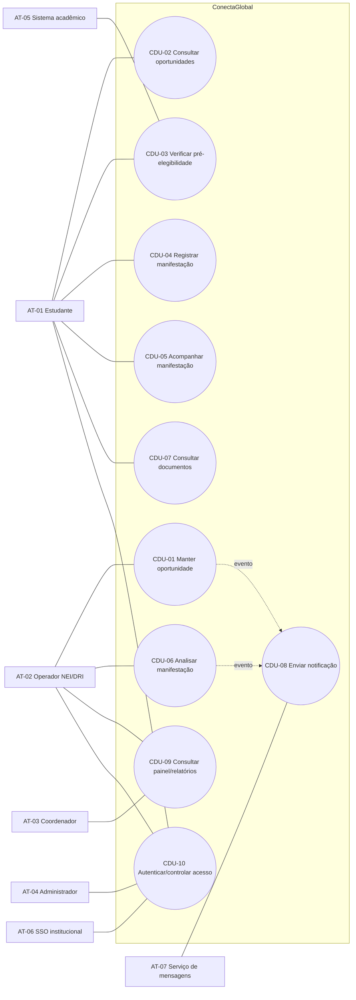
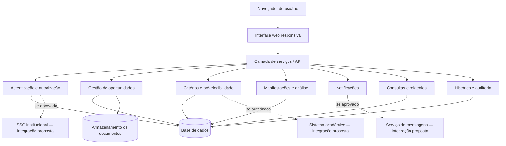
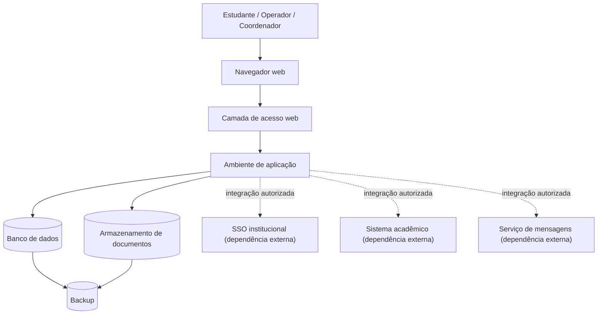

# Diagramas — ConectaGlobal

## 1. Observação metodológica

Os diagramas abaixo representam uma visão conceitual da solução. Não são decisões técnicas aprovadas pela TI da Unifor. Componentes, infraestrutura, integrações, disponibilidade e capacidade deverão ser confirmados antes de qualquer implementação.

Os casos de uso detalhados estão em [docs/07-casos-de-uso.md](../docs/07-casos-de-uso.md).

## 2. Diagrama geral de casos de uso

## 3. Diagrama conceitual de componentes

## 4. Diagrama conceitual de implantação

## 5. Limitações e decisões em aberto

- Os diagramas de componentes e implantação não determinam tecnologia, provedor, número de servidores, balanceador ou arquitetura de alta disponibilidade.
- A integração com SSO, sistema acadêmico e serviço de mensagens é hipotética.
- A camada de armazenamento de documentos é proposta; formato, limite, retenção e acesso precisam de definição.
- A participação do coordenador é potencial e depende de validação.
- O diagrama geral não substitui diagramas de atividades UML por fluxo, que podem ser produzidos durante o detalhamento dos casos de uso.
- A modelagem deve ser revisada quando as regras de negócio e os atores forem confirmados.

## 6. Histórico

| Versão | Data | Alteração |
|---|---|---|
| 1.0 | 26/11/2026 | Atualização dos diagramas e explicitação de integrações e arquitetura como hipóteses. |
