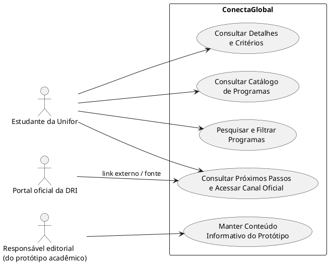
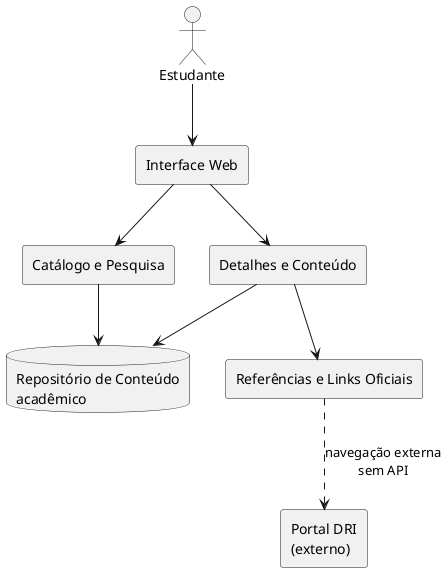
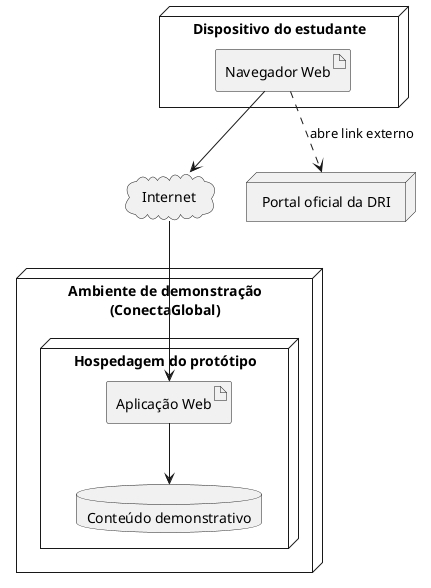

# Diagramas UML — ConectaGlobal

Os modelos abaixo estão em PlantUML para manter a notação UML explícita. O arquivo-fonte completo está em [`diagramas.puml`](diagramas.puml).

## 1. Diagrama de Casos de Uso

## 2. Diagrama de Componentes

## 3. Diagrama de Implantação

## Notas
- O portal DRI é acessado por navegação externa; não há API ou integração presumida.
- O repositório de conteúdo é conceitual para o protótipo; não representa banco institucional.
- O responsável editorial é um papel do protótipo acadêmico, não uma atribuição oficial da DRI.
