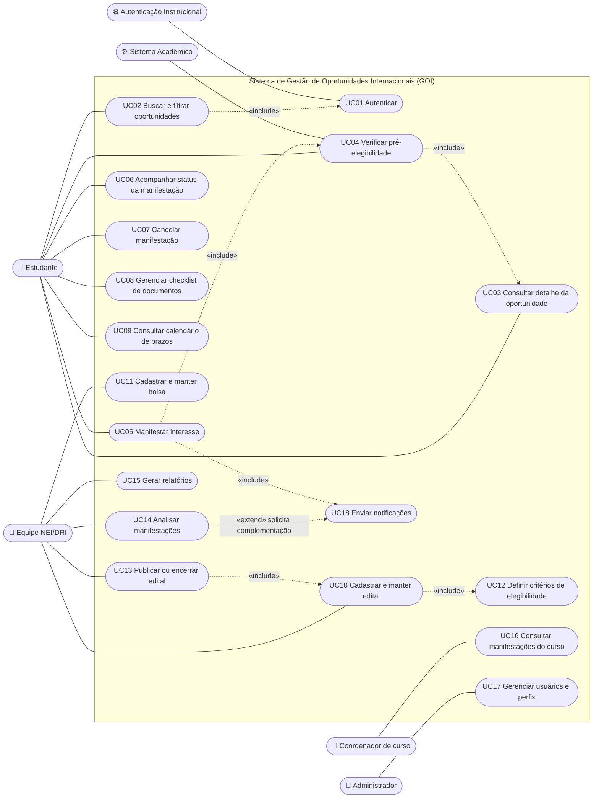
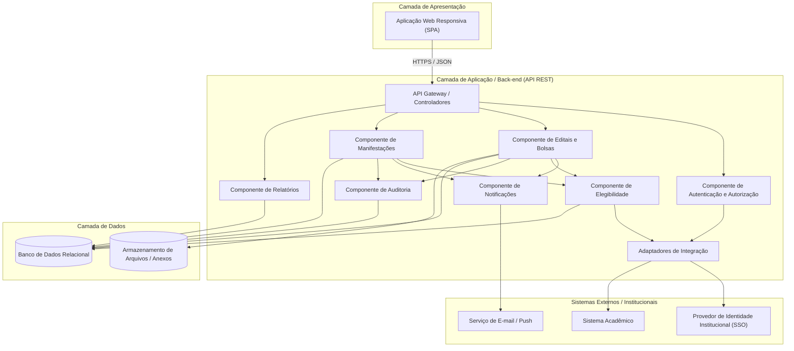
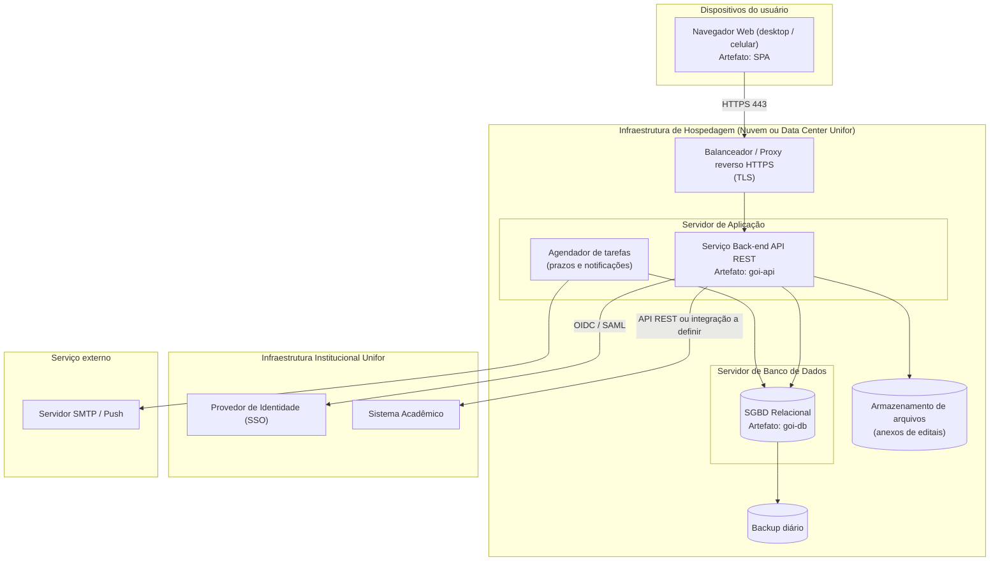

# 7. Diagramas UML (Sprint 1)

Os diagramas abaixo usam **Mermaid**, renderizado automaticamente pelo GitHub. O Mermaid não tem notação UML nativa para casos de uso, componentes e implantação, então usamos `flowchart` com a convenção visual equivalente. Nas próximas sprints os diagramas podem ser refeitos em draw.io/Astah e exportados como imagem para a pasta `uml/`.

## 7.1 Diagrama de Casos de Uso

### Descrição resumida dos principais casos de uso

| ID | Caso de uso | Ator principal | Pré-condição | Fluxo principal | Pós-condição |
|---|---|---|---|---|---|
| UC05 | Manifestar interesse | Estudante | Autenticado; edital aberto | 1. Seleciona oportunidade 2. Sistema verifica elegibilidade 3. Estudante confirma 4. Sistema registra manifestação com status *Registrada* 5. Notifica estudante | Manifestação criada |
| UC05 | (fluxo alternativo) | | | 2a. Aluno não elegível: sistema informa o motivo e não permite concluir | Nenhuma manifestação criada |
| UC10 | Cadastrar e manter edital | NEI/DRI | Autenticado com perfil NEI/DRI | 1. Informa dados 2. Define critérios (UC12) e documentos 3. Salva rascunho | Edital em rascunho |
| UC13 | Publicar edital | NEI/DRI | Edital completo (RN10) | 1. Solicita publicação 2. Sistema valida campos 3. Publica e notifica interessados | Edital publicado |
| UC14 | Analisar manifestações | NEI/DRI | Existem manifestações | 1. Filtra 2. Abre manifestação 3. Altera status/observação 4. Sistema notifica aluno | Status atualizado |

## 7.2 Diagrama de Componentes

| Componente | Responsabilidade | Requisitos |
|---|---|---|
| Autenticação e Autorização | Login via SSO e controle por perfil | RF23, RF24, RNF06 |
| Editais e Bolsas | CRUD, publicação, encerramento, histórico | RF01–RF07 |
| Elegibilidade | Avalia critérios do edital contra dados do aluno | RF04, RF11, RN05–RN07 |
| Manifestações | Registro, status, cancelamento, análise | RF12–RF14, RF17–RF19 |
| Notificações | Alertas de prazo e mudança de status | RF21, RF22, RN18 |
| Relatórios | Consultas agregadas e exportação CSV | RF20 |
| Auditoria | Registro de ações | RF07, RNF08 |
| Adaptadores de Integração | Isola SSO e sistema acadêmico (RS3) | RNF09 |

## 7.3 Diagrama de Implantação

**Premissas de implantação (a validar com a TI):** hospedagem, protocolo de SSO e forma de integração com o sistema acadêmico ainda não foram definidos e dependem de autorização institucional (RS3, premissas P1 e P2).
