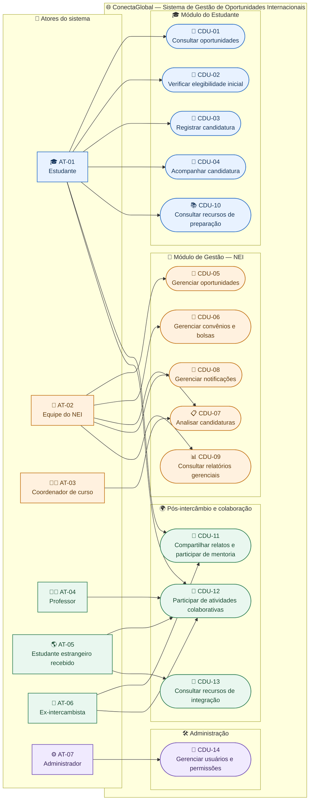
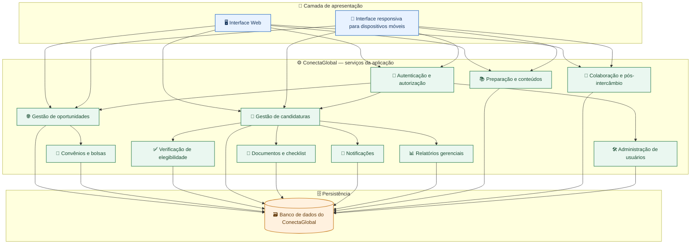
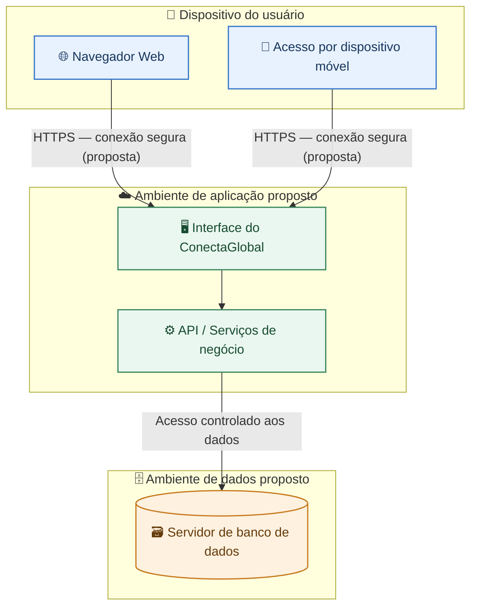

# Diagramas do ConectaGlobal

Diagramas em Mermaid com apresentação visual ilustrada para facilitar a leitura no GitHub. Os ícones são apenas recursos visuais; os atores, funcionalidades e relações seguem os documentos de requisitos e casos de uso.

## 1. Diagrama de Casos de Uso

## 2. Diagrama de Componentes

## 3. Diagrama de Implantação

## Observações

- A implantação é uma representação lógica proposta, não uma infraestrutura já contratada ou implementada.
- Não foram incluídos sistemas externos porque nenhuma integração técnica foi confirmada na documentação-base.
- A DRI não aparece como ator, componente ou nó: é somente referência visual para a etapa de telas.
- O ator **Equipe do NEI** foi preservado como responsável pelas funções de gestão.
- Para rastreabilidade, os códigos CDU correspondem à especificação em [`docs/08-casos-de-uso.md`](../docs/08-casos-de-uso.md), e os atores AT à relação em [`docs/02-partes-interessadas-e-atores.md`](../docs/02-partes-interessadas-e-atores.md).
