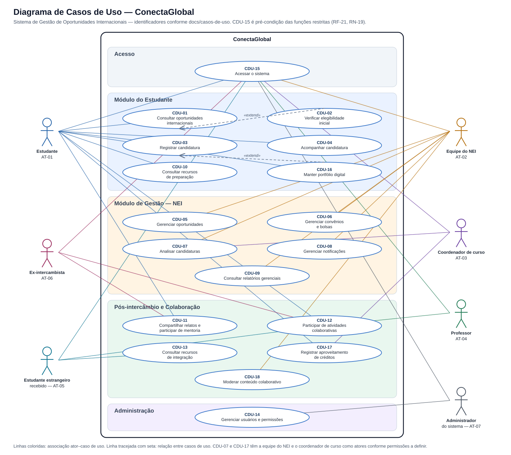
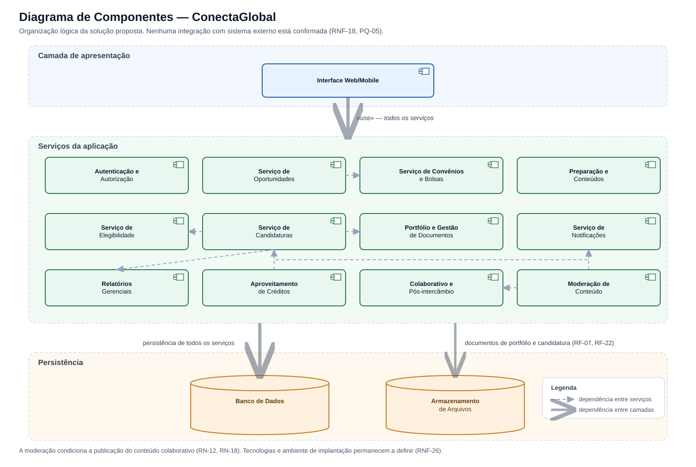
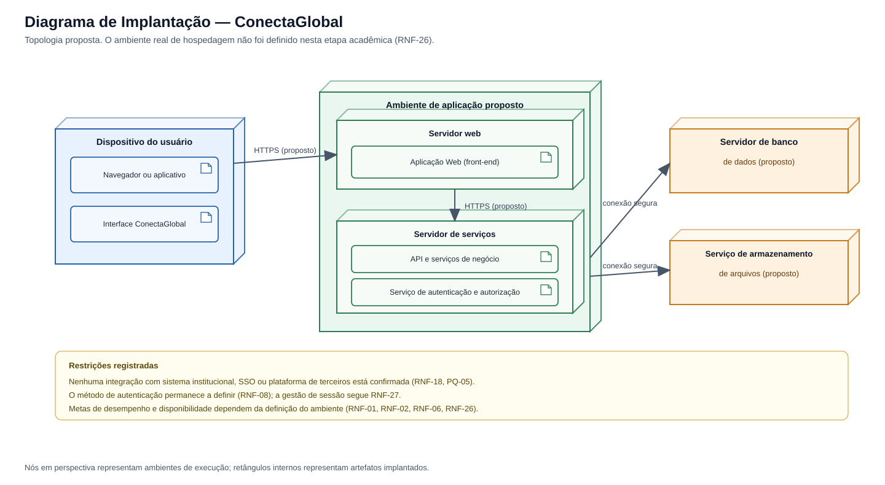
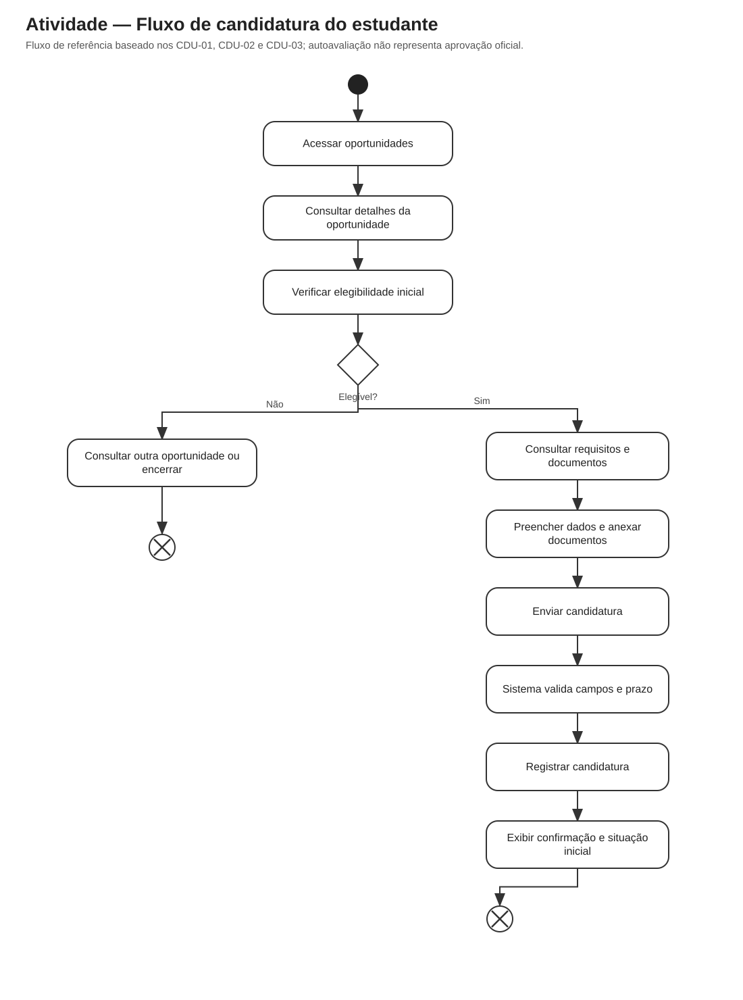
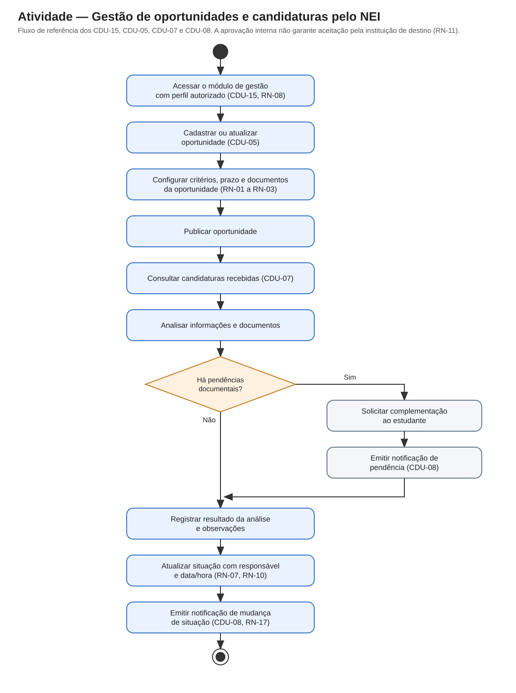
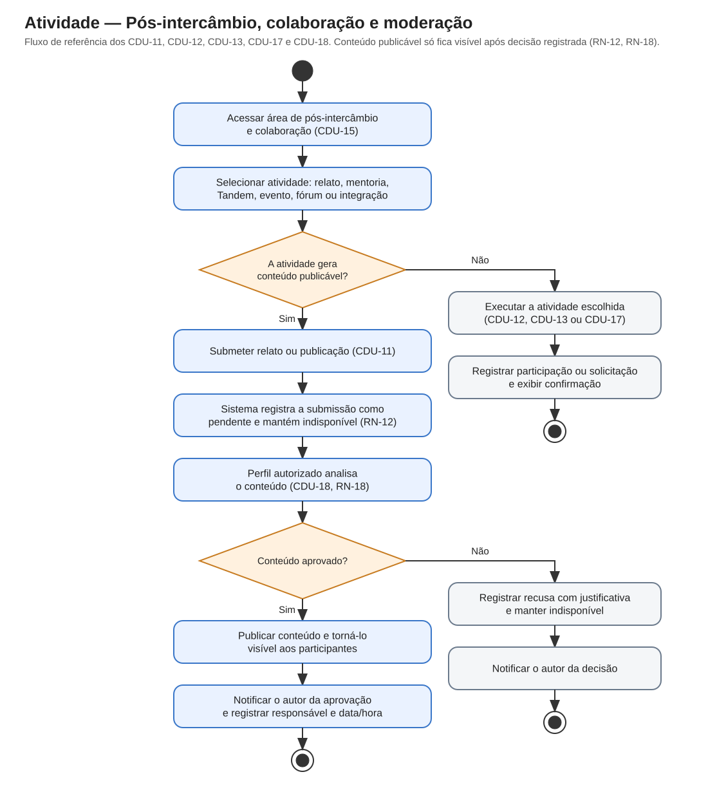

# Diagramas UML — ConectaGlobal

Todos os diagramas estão disponíveis em três formatos: **SVG** (visualização direta no GitHub, vetorial), **PNG** em `png/` (para slides e documentos) e **PlantUML** (`.puml`, fonte editável).

Os identificadores usados nos diagramas são os mesmos dos documentos de requisitos: **CDU-01 a CDU-18**, com rastreabilidade para `../docs/08-casos-de-uso.md`, requisitos (RF) e regras de negócio (RN).

---

## 1. Diagrama de Casos de Uso

Dezoito casos de uso organizados nos módulos da Visão da Demanda: Acesso, Estudante, Gestão (NEI), Pós-intercâmbio e Colaboração, e Administração. Sete atores (AT-01 a AT-07).

CDU-15 é pré-condição das funções restritas (RF-21, RN-19). As relações `«extend»` representam a autoavaliação acionada a partir da consulta de oportunidades e o reaproveitamento do portfólio ao registrar candidatura.

---

## 2. Diagrama de Componentes

Três camadas: apresentação, serviços da aplicação e persistência. As dependências entre serviços estão desenhadas — Candidaturas depende de Elegibilidade, Documentos, Notificações e Relatórios; Oportunidades depende de Convênios; Moderação atua sobre o módulo colaborativo e as notificações (RN-12, RN-18).

---

## 3. Diagrama de Implantação

Topologia proposta com dispositivo do usuário, ambiente de aplicação (servidor web e servidor de serviços) e persistência separada em banco de dados e armazenamento de arquivos. O ambiente real de hospedagem não foi definido (RNF-26) e nenhuma integração externa está confirmada (RNF-18, PQ-05).

---

## 4. Diagramas de Atividades

### 4.1 Fluxo de candidatura do estudante

Percorre CDU-15, CDU-01, CDU-02, CDU-16 e CDU-03. A autoavaliação apresenta resultado indicativo e **não impede a candidatura** — a decisão é do estudante (RN-04). A verificação de prazo segue RN-09.

### 4.2 Gestão de oportunidades e candidaturas pelo NEI

Percorre CDU-15, CDU-05, CDU-07 e CDU-08. Toda atualização de situação registra responsável e data/hora (RN-07, RN-10).

### 4.3 Pós-intercâmbio, colaboração e moderação

Percorre CDU-11, CDU-12, CDU-13, CDU-17 e CDU-18. Conteúdo publicável só fica visível após decisão registrada de moderação (RN-12, RN-18).

---

## Arquivos

| Diagrama | SVG | PNG | Fonte PlantUML |
|---|---|---|---|
| Casos de uso | `casos-de-uso.svg` | `png/casos-de-uso.png` | `diagramas.puml` |
| Componentes | `componentes.svg` | `png/componentes.png` | `diagramas.puml` |
| Implantação | `implantacao.svg` | `png/implantacao.png` | `diagramas.puml` |
| Atividade — estudante | `atividade-estudante.svg` | `png/atividade-estudante.png` | `atividades.puml` |
| Atividade — gestão NEI | `atividade-gestao-nei.svg` | `png/atividade-gestao-nei.png` | `atividades.puml` |
| Atividade — pós-intercâmbio | `atividade-pos-intercambio.svg` | `png/atividade-pos-intercambio.png` | `atividades.puml` |

Os fluxos são propostas de modelagem derivadas das especificações dos casos de uso. Não representam processo institucional validado.
